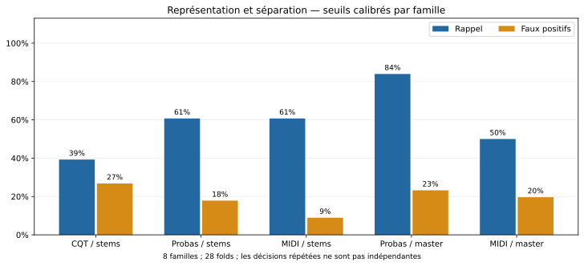

# CQT, probabilités Basic Pitch, MIDI et séparation

## Question et protocole

Ces deux expériences suivent le [protocole fixé avant calcul](protocole.md).
On compare chaque chanson IA GEMA à chaque original : 64 paires uniques,
dont 8 correspondances attendues et 56 négatifs. Aucun classement de catalogue
n'entre dans le verdict. Les mêmes 28 folds par famille servent à calibrer
les seuils sur les six familles d'entraînement, puis à tester les deux autres.
Les 56 décisions positives sont des répétitions de huit paires, pas 56 cas
indépendants. Ces données ont déjà servi à explorer le pipeline : aucun test
final indépendant n'est disponible.

La CQT est celle du frontal Basic Pitch 0.4.0 (TensorFlow), avant batch
normalization et convolutions, sur les mêmes fenêtres audio que l'inférence.
On moyenne ses trois bandes par demi-ton et conserve les 88 notes A0–C8.
Le réseau bénéficie aussi du contexte des harmoniques au-delà de cette
plage de sortie ; ce contrôle compare l'utilité de deux représentations,
sans isoler chaque mécanisme interne du réseau.
Les trois représentations regroupent les octaves par maximum puis moyennent
sur 500 ms. Le MIDI est décodé à partir de l'inférence comparée, avec vélocité
et temps quantifiés par un aller-retour MIDI. Les probabilités sont des
activations du modèle, pas des probabilités calibrées de plagiat.

La comparaison utilise des fenêtres de 10 s, un pas de 2 s, 12 transpositions
et les six rapports temporels historiques. La fusion `bass` + `other` moyenne
les matrices avant de choisir leur maximum commun. La transposition peut
différer entre stems, comme dans la baseline historique. Le score local et
la fusion ne sont pas réoptimisés pour cette expérience.

## Résultats avec seuil d'exactitude équilibrée

| Variante | VP | FN | FP | Rappel | FPR | F1 |
| --- | --- | --- | --- | --- | --- | --- |
| stems-cqt | 22/56 | 34/56 | 15/56 | 0.393 | 0.268 | 0.473 |
| stems-probability | 34/56 | 22/56 | 10/56 | 0.607 | 0.179 | 0.680 |
| stems-midi | 34/56 | 22/56 | 5/56 | 0.607 | 0.089 | 0.716 |
| stems-midi-bass035 | 34/56 | 22/56 | 5/56 | 0.607 | 0.089 | 0.716 |
| stems-probability-onsets | 36/56 | 20/56 | 12/56 | 0.643 | 0.214 | 0.692 |
| stems-midi-onsets | 35/56 | 21/56 | 8/56 | 0.625 | 0.143 | 0.707 |
| mix-probability | 47/56 | 9/56 | 13/56 | 0.839 | 0.232 | 0.810 |
| mix-midi | 28/56 | 28/56 | 11/56 | 0.500 | 0.196 | 0.589 |
| mix-probability-onsets | 46/56 | 10/56 | 18/56 | 0.821 | 0.321 | 0.767 |
| mix-midi-onsets | 27/56 | 29/56 | 2/56 | 0.482 | 0.036 | 0.635 |



## Résultats avec cible de FPR d'entraînement ≤ 10 %

| Variante | VP | FN | FP | Rappel | FPR | F1 |
| --- | --- | --- | --- | --- | --- | --- |
| stems-cqt | 26/56 | 30/56 | 9/56 | 0.464 | 0.161 | 0.571 |
| stems-probability | 36/56 | 20/56 | 9/56 | 0.643 | 0.161 | 0.713 |
| stems-midi | 35/56 | 21/56 | 5/56 | 0.625 | 0.089 | 0.729 |
| stems-midi-bass035 | 34/56 | 22/56 | 7/56 | 0.607 | 0.125 | 0.701 |
| stems-probability-onsets | 36/56 | 20/56 | 9/56 | 0.643 | 0.161 | 0.713 |
| stems-midi-onsets | 38/56 | 18/56 | 8/56 | 0.679 | 0.143 | 0.745 |
| mix-probability | 29/56 | 27/56 | 9/56 | 0.518 | 0.161 | 0.617 |
| mix-midi | 33/56 | 23/56 | 6/56 | 0.589 | 0.107 | 0.695 |
| mix-probability-onsets | 22/56 | 34/56 | 10/56 | 0.393 | 0.179 | 0.500 |
| mix-midi-onsets | 35/56 | 21/56 | 8/56 | 0.625 | 0.143 | 0.707 |

Le seuil est choisi sur l'entraînement uniquement. Le FPR mesuré sur les
familles tenues à l'écart n'est donc pas garanti inférieur à 10 %.

## Résultats par famille

| Famille | stems-cqt | stems-probability | stems-midi | stems-midi-bass035 | stems-probability-onsets | stems-midi-onsets | mix-probability | mix-midi | mix-probability-onsets | mix-midi-onsets |
| --- | --- | --- | --- | --- | --- | --- | --- | --- | --- | --- |
| big-in-japan-alphaville | 2/7 | 7/7 | 7/7 | 7/7 | 7/7 | 7/7 | 6/7 | 6/7 | 6/7 | 7/7 |
| brother-louie-modern-talking | 0/7 | 0/7 | 0/7 | 0/7 | 0/7 | 0/7 | 0/7 | 0/7 | 7/7 | 0/7 |
| cheri-cheri-lady-modern-talking | 7/7 | 7/7 | 7/7 | 7/7 | 7/7 | 7/7 | 7/7 | 7/7 | 7/7 | 7/7 |
| daddy-cool-boney-m | 7/7 | 7/7 | 6/7 | 6/7 | 7/7 | 7/7 | 7/7 | 7/7 | 7/7 | 6/7 |
| forever-young-alphaville | 0/7 | 7/7 | 7/7 | 7/7 | 7/7 | 7/7 | 7/7 | 7/7 | 6/7 | 7/7 |
| mambo-no-5-lou-bega | 6/7 | 0/7 | 0/7 | 0/7 | 0/7 | 0/7 | 6/7 | 0/7 | 0/7 | 0/7 |
| rasputin-boney-m | 0/7 | 0/7 | 7/7 | 7/7 | 1/7 | 6/7 | 7/7 | 1/7 | 7/7 | 0/7 |
| youre-my-heart-youre-my-soul-modern-talking | 0/7 | 6/7 | 0/7 | 0/7 | 7/7 | 1/7 | 7/7 | 0/7 | 6/7 | 0/7 |

## Interprétation

Sur les stems identiques, la CQT atteint F1 **0.473**, les sorties
continues `note` **0.680**, et les événements MIDI **0.716**.
La différence probabilités moins CQT est **+0.207** ;
MIDI moins probabilités est **+0.036**. Cela mesure
l'utilité de ces étapes pour la tâche, pas la fidélité des notes transcrites :
aucune partition de référence n'a été annotée.

À représentation identique, séparer avant Basic Pitch change le F1 de
**-0.130** pour
les probabilités, et de **+0.126**
pour le MIDI. Le contrôle principal utilise partout le seuil de trame 0.30.
La variante `bass035` reproduit le réglage 0.35 de la basse historique.
La séparation n'a donc pas un effet bénéfique universel : son intérêt dépend
de la représentation et du décodage utilisés en aval. Le passage au MIDI
sur stems conserve ici le même nombre de vrais positifs que les probabilités,
avec moins de faux positifs. À l'inverse, décoder en MIDI le master complet
dégrade les résultats dans ce contrôle.
L'ajout des attaques est secondaire ; sa pondération relative n'a pas été
optimisée et les distributions des impulsions MIDI et des activations réseau
diffèrent. Un petit écart ne suffit pas à conclure sur huit familles.

Ces résultats ne remplacent pas automatiquement le pipeline fusionné
historique : cette expérience isole des représentations, avec une agrégation
commune différente de la rasterisation MIDI historique (présence sur une
trame contre activité moyenne). Les scores des deux protocoles ne sont pas
interchangeables et leurs seuils sont calibrés séparément.

## Fichiers et reproduction

- Scores : `experiences/10/pitch-ablation-scores.csv`.
- Décisions et seuils par fold : `experiences/10/pitch-ablation-decisions.csv`.
- Versions et empreinte du modèle : `experiences/10/pitch-experiments-environment.json`.
- Caches régénérables et sorties continues : `sandbox/pitch-experiments/`.

```sh
uv run --script experiences/10/run.py --stage extract
uv run --script experiences/10/run.py --stage evaluate
```

Sources audio et logiciels : [CREDITS.md](../../CREDITS.md),
[GEMA](https://www.gema.de/en/news/ai-and-music/ai-lawsuit/audio-samples-suno),
[Basic Pitch](https://github.com/spotify/basic-pitch),
[article Basic Pitch](https://arxiv.org/abs/2203.09893),
[Spleeter](https://github.com/deezer/spleeter).
