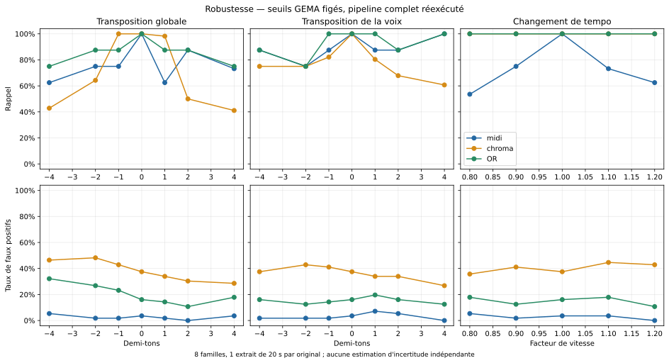

# Robustesse du pipeline aux transformations contrôlées

## Protocole et calibration

Le [protocole fixé avant calcul](../10/protocole.md) prend un seul
extrait de 20 s, à partir de 30 s, dans chacun des huit originaux. Les
positions ne sont pas choisies selon la qualité de la détection. Chaque
extrait est comparé aux huit masters originaux complets.

Les 18 conditions comprennent l'extrait inchangé, la somme des cinq stems,
six transpositions globales, six transpositions de voix seule et quatre
changements de tempo. Les transformations utilisent le filtre Rubber Band
de FFmpeg, avec conservation des formants et traitement stéréo conjoint.
L'audio est stocké en WAV flottant, sans normalisation ni réduction automatique
de gain. Pour la voix seule, le signal transformé remplace la voix dans la
somme des stems ; il est comparé au témoin reconstruit. Les artefacts Spleeter
et Rubber Band font partie des limites de ce contrôle.

Chaque version repasse réellement dans Spleeter puis Basic Pitch. La branche
MIDI utilise la rasterisation historique, seuil de trame 0.35 pour la basse
et 0.30 pour `other`. La branche chroma utilise l'extracteur historique sur
les échantillons flottants. Le score MIDI est le maximum synchronisé ; le
score chroma impose trois fenêtres consécutives. La règle OR est inchangée.

Pour chaque fold, les seuils sont calculés sur les six familles GEMA
non transformées d'entraînement. Ils sont ensuite figés pour toutes les
transformations des deux autres familles. Le contrôle de calibration
reproduit exactement **47/56 VP et 8/56 FP** de la règle OR historique.
Les résultats ci-dessous ne réajustent aucun seuil aux copies synthétiques.

## Résultats

| Condition | VP MIDI | FP MIDI | VP chroma | FP chroma | VP OR | FP OR | Δ score MIDI | Δ score chroma |
| --- | --- | --- | --- | --- | --- | --- | --- | --- |
| unchanged | 56/56 | 2/56 | 56/56 | 21/56 | 56/56 | 9/56 | +0.0000 | +0.0000 |
| reconstructed | 56/56 | 2/56 | 56/56 | 21/56 | 56/56 | 9/56 | -0.0002 | -0.0000 |
| global-pitch--4 | 35/56 | 3/56 | 24/56 | 26/56 | 42/56 | 18/56 | -0.1598 | -0.0245 |
| global-pitch--2 | 42/56 | 1/56 | 36/56 | 27/56 | 49/56 | 15/56 | -0.1382 | -0.0190 |
| global-pitch--1 | 42/56 | 1/56 | 56/56 | 24/56 | 49/56 | 13/56 | -0.1205 | -0.0108 |
| global-pitch-+1 | 35/56 | 1/56 | 55/56 | 19/56 | 49/56 | 8/56 | -0.1581 | -0.0120 |
| global-pitch-+2 | 49/56 | 0/56 | 28/56 | 17/56 | 49/56 | 6/56 | -0.1041 | -0.0243 |
| global-pitch-+4 | 41/56 | 2/56 | 23/56 | 16/56 | 42/56 | 10/56 | -0.1833 | -0.0299 |
| vocal-pitch--4 | 49/56 | 1/56 | 42/56 | 21/56 | 49/56 | 9/56 | -0.0489 | -0.0170 |
| vocal-pitch--2 | 42/56 | 1/56 | 42/56 | 24/56 | 42/56 | 7/56 | -0.0400 | -0.0161 |
| vocal-pitch--1 | 49/56 | 1/56 | 46/56 | 23/56 | 56/56 | 8/56 | -0.0470 | -0.0128 |
| vocal-pitch-+1 | 49/56 | 4/56 | 45/56 | 19/56 | 56/56 | 11/56 | -0.0458 | -0.0136 |
| vocal-pitch-+2 | 49/56 | 3/56 | 38/56 | 19/56 | 49/56 | 9/56 | -0.0379 | -0.0183 |
| vocal-pitch-+4 | 56/56 | 0/56 | 34/56 | 15/56 | 56/56 | 7/56 | -0.0186 | -0.0205 |
| tempo-0.8 | 30/56 | 3/56 | 56/56 | 20/56 | 56/56 | 10/56 | -0.1772 | -0.0083 |
| tempo-0.9 | 42/56 | 1/56 | 56/56 | 23/56 | 56/56 | 7/56 | -0.1605 | -0.0091 |
| tempo-1.1 | 41/56 | 2/56 | 56/56 | 25/56 | 56/56 | 10/56 | -0.1861 | -0.0069 |
| tempo-1.2 | 35/56 | 0/56 | 56/56 | 24/56 | 56/56 | 6/56 | -0.2107 | -0.0078 |



Les écarts de score sont calculés sur les huit correspondances positives
uniques, contre l'extrait inchangé pour les transformations globales, et
contre la reconstruction inchangée pour les voix transposées. Une hausse
du score seule n'est pas une réussite si les faux positifs augmentent.
Le tempo indique le facteur de vitesse (0.8 = plus lent ; 1.2 = plus rapide).
Les rapports temporels testés par le détecteur restent ceux du POC ; une
dégradation peut donc venir de leur discrétisation autant que de l'extraction.

## Conclusions de ce contrôle

Le témoin inchangé donne **56/56**
détections positives et **9/56** faux
positifs pour la fusion. La reconstruction des stems donne les mêmes comptes
dans ce corpus ; elle constitue donc ici un témoin utile pour la voix seule.

Pour les changements de tempo, le rappel de la fusion va de
**100.0% à 100.0%**.
La chroma maintient les correspondances que la branche MIDI peut perdre.
La fusion garde néanmoins entre
**6/56 et 10/56**
faux positifs : conserver les positifs ne signifie pas classer toutes les
paires correctement.

La transposition globale est plus problématique : à -4 demi-tons, la fusion
ne conserve que **42/56** positifs
avec **18/56** faux positifs ; à
+4 demi-tons, elle conserve **42/56**
positifs avec **10/56** faux positifs.
Les échecs positifs concernent ici *Brother Louie* et *You're My Heart,
You're My Soul*. La voix seule transposée de -2 demi-tons fait également
tomber le nombre de détections à **42/56**.

Tester les douze décalages de classes de hauteur dans le comparateur ne
garantit donc pas l'invariance de la chaîne à une transformation audio.
La transformation, la séparation et la transcription peuvent modifier les
activations au-delà d'un simple décalage circulaire. Ce contrôle constate
la dégradation sans attribuer précisément sa cause à l'une de ces étapes.

## Rasputin

| Condition | VP MIDI | VP chroma | VP OR |
| --- | --- | --- | --- |
| unchanged | 7/7 | 7/7 | 7/7 |
| reconstructed | 7/7 | 7/7 | 7/7 |
| global-pitch--4 | 0/7 | 7/7 | 7/7 |
| global-pitch--2 | 0/7 | 7/7 | 7/7 |
| global-pitch--1 | 0/7 | 7/7 | 7/7 |
| global-pitch-+1 | 0/7 | 7/7 | 7/7 |
| global-pitch-+2 | 7/7 | 7/7 | 7/7 |
| global-pitch-+4 | 6/7 | 7/7 | 7/7 |
| vocal-pitch--4 | 7/7 | 7/7 | 7/7 |
| vocal-pitch--2 | 7/7 | 7/7 | 7/7 |
| vocal-pitch--1 | 7/7 | 7/7 | 7/7 |
| vocal-pitch-+1 | 7/7 | 7/7 | 7/7 |
| vocal-pitch-+2 | 7/7 | 7/7 | 7/7 |
| vocal-pitch-+4 | 7/7 | 7/7 | 7/7 |
| tempo-0.8 | 0/7 | 7/7 | 7/7 |
| tempo-0.9 | 0/7 | 7/7 | 7/7 |
| tempo-1.1 | 6/7 | 7/7 | 7/7 |
| tempo-1.2 | 0/7 | 7/7 | 7/7 |

Il s'agit d'un extrait de l'original transformé de manière contrôlée, pas
de l'extrait IA GEMA. Une réussite ne prouve pas une résistance à toutes
les transformations d'une génération IA.

## Stabilité par famille de la règle OR

| Famille | unchanged | reconstructed | global-pitch--4 | global-pitch--2 | global-pitch--1 | global-pitch-+1 | global-pitch-+2 | global-pitch-+4 | vocal-pitch--4 | vocal-pitch--2 | vocal-pitch--1 | vocal-pitch-+1 | vocal-pitch-+2 | vocal-pitch-+4 | tempo-0.8 | tempo-0.9 | tempo-1.1 | tempo-1.2 |
| --- | --- | --- | --- | --- | --- | --- | --- | --- | --- | --- | --- | --- | --- | --- | --- | --- | --- | --- |
| big-in-japan-alphaville | 7/7 | 7/7 | 7/7 | 7/7 | 7/7 | 7/7 | 7/7 | 7/7 | 7/7 | 7/7 | 7/7 | 7/7 | 7/7 | 7/7 | 7/7 | 7/7 | 7/7 | 7/7 |
| brother-louie-modern-talking | 7/7 | 7/7 | 0/7 | 0/7 | 0/7 | 0/7 | 0/7 | 0/7 | 0/7 | 0/7 | 7/7 | 7/7 | 0/7 | 7/7 | 7/7 | 7/7 | 7/7 | 7/7 |
| cheri-cheri-lady-modern-talking | 7/7 | 7/7 | 7/7 | 7/7 | 7/7 | 7/7 | 7/7 | 7/7 | 7/7 | 7/7 | 7/7 | 7/7 | 7/7 | 7/7 | 7/7 | 7/7 | 7/7 | 7/7 |
| daddy-cool-boney-m | 7/7 | 7/7 | 7/7 | 7/7 | 7/7 | 7/7 | 7/7 | 7/7 | 7/7 | 7/7 | 7/7 | 7/7 | 7/7 | 7/7 | 7/7 | 7/7 | 7/7 | 7/7 |
| forever-young-alphaville | 7/7 | 7/7 | 7/7 | 7/7 | 7/7 | 7/7 | 7/7 | 7/7 | 7/7 | 7/7 | 7/7 | 7/7 | 7/7 | 7/7 | 7/7 | 7/7 | 7/7 | 7/7 |
| mambo-no-5-lou-bega | 7/7 | 7/7 | 7/7 | 7/7 | 7/7 | 7/7 | 7/7 | 7/7 | 7/7 | 7/7 | 7/7 | 7/7 | 7/7 | 7/7 | 7/7 | 7/7 | 7/7 | 7/7 |
| rasputin-boney-m | 7/7 | 7/7 | 7/7 | 7/7 | 7/7 | 7/7 | 7/7 | 7/7 | 7/7 | 7/7 | 7/7 | 7/7 | 7/7 | 7/7 | 7/7 | 7/7 | 7/7 | 7/7 |
| youre-my-heart-youre-my-soul-modern-talking | 7/7 | 7/7 | 0/7 | 7/7 | 7/7 | 7/7 | 7/7 | 0/7 | 7/7 | 0/7 | 7/7 | 7/7 | 7/7 | 7/7 | 7/7 | 7/7 | 7/7 | 7/7 |

## Limites et fichiers

On dispose toujours de huit familles indépendantes et d'un seul passage
par original. Les 56 décisions positives par condition répètent chaque
paire sept fois avec différents seuils, et les 56 négatifs sont les paires
entre morceaux différents. Les variantes ne sont pas des observations
indépendantes. Le contrôle synthétique mesure la robustesse à des
transformations connues ; il ne mesure pas le taux d'erreur sur de nouveaux
plagiats IA. Il ne permet pas non plus de tester la robustesse à des
modifications importantes de mélodie, d'arrangement ou de structure.

Les scores, décisions par fold, résumés, manifeste des extraits et audit de
calibration sont dans `experiences/12/pitch-robustness-*.csv`. Les audios
et caches régénérables sont dans `sandbox/pitch-experiments/`. Le dataset
original est conservé intact.

```sh
uv run --script experiences/12/run.py --stage build
uv run --script experiences/12/run.py --stage extract
uv run --script experiences/12/run.py --stage evaluate
```

Sources : [CREDITS.md](../../CREDITS.md),
[GEMA](https://www.gema.de/en/news/ai-and-music/ai-lawsuit/audio-samples-suno),
[Basic Pitch](https://github.com/spotify/basic-pitch),
[Spleeter](https://github.com/deezer/spleeter),
[Rubber Band](https://breakfastquay.com/rubberband/).
